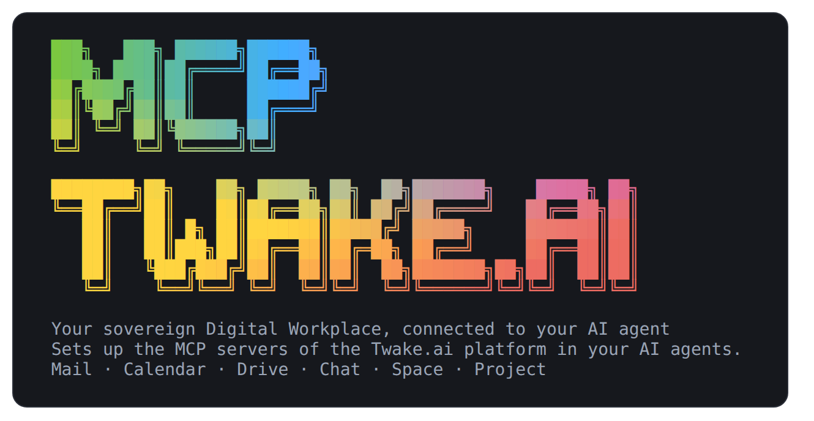
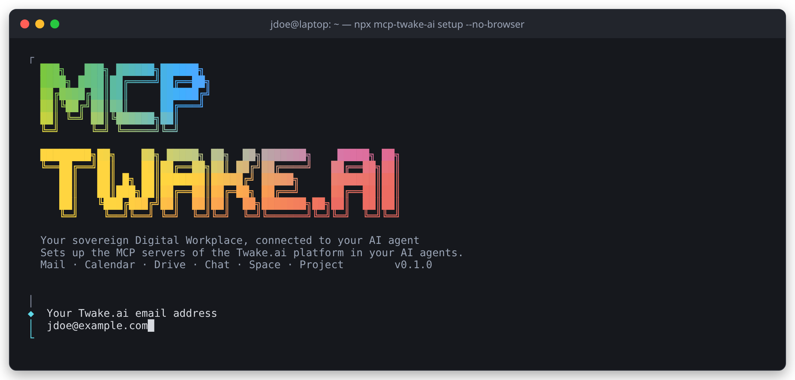
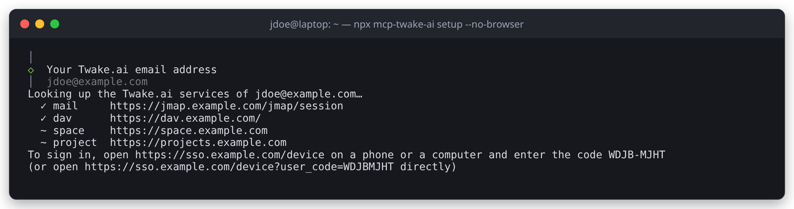
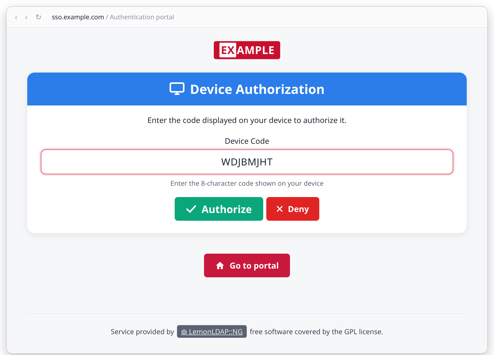
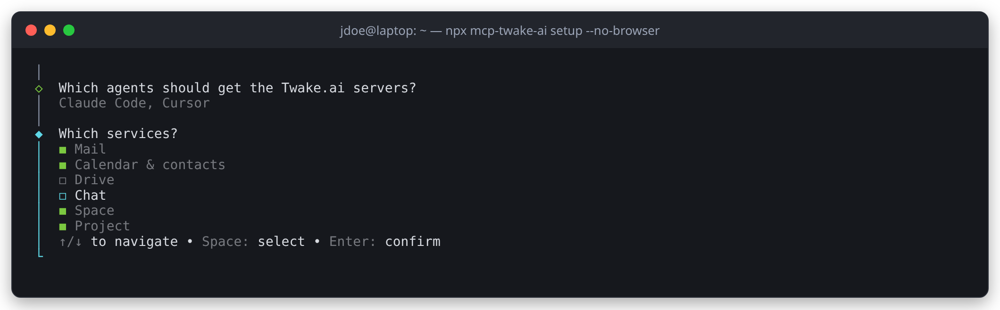
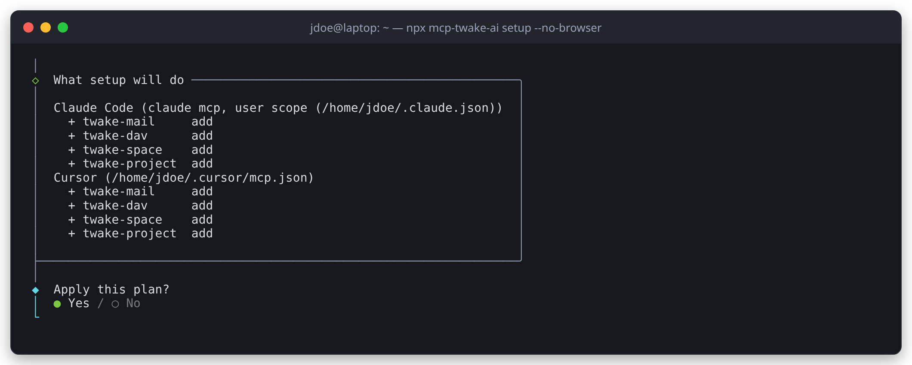
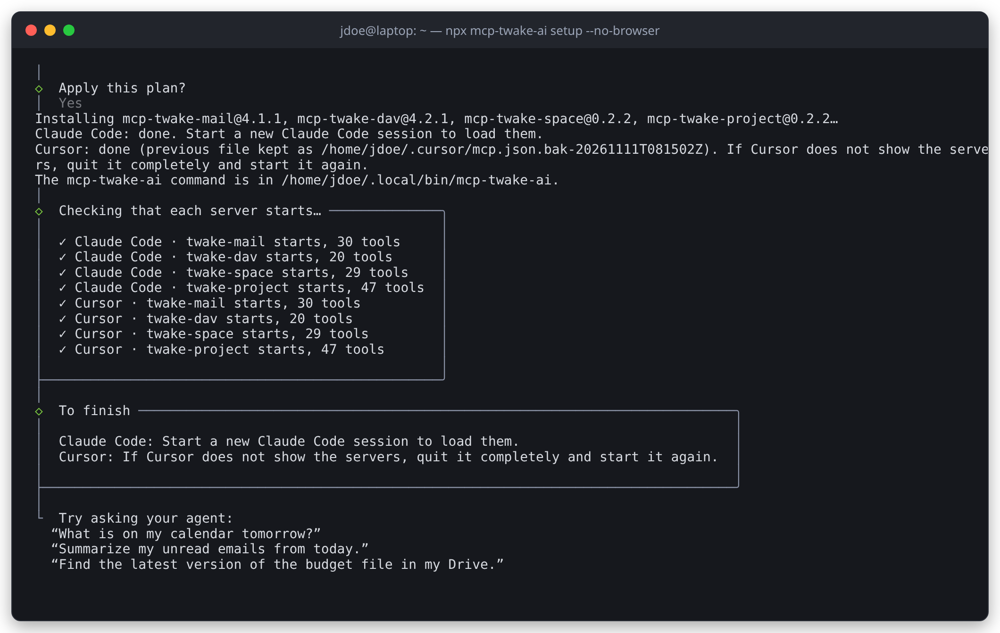

# mcp-twake-ai

[](https://www.npmjs.com/package/mcp-twake-ai)
[](https://github.com/linagora/mcp-twake-ai/actions/workflows/ci.yml)
[](LICENSE)
[](https://nodejs.org/)

<p align="center">
  
</p>

**One command connects your AI agent to [Twake.ai](https://twake.ai): Mail, Calendar, Drive, Chat, Space and Project, with a single sign-in.**

```bash
npx mcp-twake-ai setup
```

## What is it?

`mcp-twake-ai` sets up the six Twake.ai [Model Context Protocol](https://modelcontextprotocol.io) (MCP) servers in your AI agents (Claude Code, Hermes, Claude Desktop, Cursor and VS Code), and gives any other agent a ready-made configuration.

You type your email address and sign in once at your Twake.ai identity provider. `mcp-twake-ai` finds your services, writes them into the agents you choose, then stays behind as their token broker: the refresh token sits in your operating system's keychain, and each MCP server gets a fresh access token whenever it needs one. No password or token is written into an agent's configuration.

## Part of Twake.ai

[Twake.ai](https://twake.ai) is the truly open source and sovereign Digital Workplace developed by [LINAGORA](https://linagora.com): Twake Mail, Twake Calendar, Twake Drive, Twake Chat, Twake Space and Twake Visio with a single account, hosted in France or on your own infrastructure.

`mcp-twake-ai` installs and connects its six open source MCP servers:

| MCP server                                                         | Twake.ai service                        | Protocol          |
| ------------------------------------------------------------------ | --------------------------------------- | ----------------- |
| [mcp-twake-mail](https://github.com/linagora/mcp-twake-mail)       | Twake Mail                              | JMAP              |
| [mcp-twake-dav](https://github.com/linagora/mcp-twake-dav)         | Twake Calendar and contacts             | CalDAV / CardDAV  |
| [mcp-twake-drive](https://github.com/linagora/mcp-twake-drive)     | Twake Drive                             | cozy-stack API    |
| [mcp-twake-chat](https://github.com/linagora/mcp-twake-chat)       | Twake Chat                              | Matrix            |
| [mcp-twake-space](https://github.com/linagora/mcp-twake-space)     | Twake Space (team spaces)               | Twake Space API   |
| [mcp-twake-project](https://github.com/linagora/mcp-twake-project) | Twake Project (projects, boards, tasks) | Twake Project API |

## Requirements

- **Node.js** >= 22.13
- An account on the Twake.ai SaaS
- One of the agents above, or any MCP client for `export`

Your identity provider needs the public OIDC client `twake-ai-agents` (PKCE, `offline_access`, loopback redirect URIs `http://127.0.0.1:8765/callback` to `:8767`, device flow, and the audiences of the Twake.ai backends). It exists on the Twake.ai SaaS; another client can be used with `--client-id` or `TWAKE_AI_OIDC_CLIENT_ID`.

## Start here

Run it in a terminal, from any folder:

```bash
npx mcp-twake-ai setup
```

The guided setup asks a few questions and changes nothing before you confirm. It speaks English (`TWAKE_AI_LANGUAGE=fr` switches it to French), and pressing Escape at any question leaves everything as it was.

**1. Your Twake.ai email address.** It is enough to find your services.



**2. Sign in once.** Your browser opens on your Twake.ai sign-in page. Over SSH, without a display or with `--no-browser`, the terminal shows a code to enter from your phone or another computer instead:





**3. Choose the agents and the services.** The agents found on this computer, and the services of your account, are ticked in advance.



**4. Check the plan, and confirm.** Each agent gets one entry per service: `twake-mail`, `twake-dav`…



**5. Done.** The servers are installed, written into your agents, and each one is started once to check it answers.



Under `npx`, `mcp-twake-ai` copies itself into its private folder, so that your agents never depend on npx's cache, and puts a `mcp-twake-ai` command in `~/.local/bin` (`%LOCALAPPDATA%\twake-ai\bin` on Windows).

## Use it from Claude Code

Start a new `claude` session: `/mcp` lists the `twake-*` servers. Then ask in plain words. Reads happen at once; every write is shown to you for approval first (illustrative, abridged session):

```text
> What's on my calendar tomorrow? Draft a reply to Pierre's last email with my free slots.

⏺ twake-dav - get_events_in_range (MCP)(when: "tomorrow")
  ⎿  3 events: 09:30 Team stand-up · 11:00 Budget review · 15:00 Call with Acme

⏺ twake-mail - search_emails (MCP)(from: "pierre", limit: 1)
  ⎿  "Workshop next week?" from Pierre Martin, yesterday at 17:42

⏺ twake-mail - create_draft (MCP)(to: ["pierre.martin@example.com"], subject: "Re: Workshop next week?", …)

  ╭─ twake-mail asks for your approval ────────────────╮
  │ Create a draft                                     │
  │ to: pierre.martin@example.com                      │
  │ subject: Re: Workshop next week?                   │
  │                                                    │
  │ ❯ Accept   Decline                                 │
  ╰────────────────────────────────────────────────────╯
  ⎿  Draft saved

⏺ Tomorrow you have the stand-up at 9:30, the budget review at 11:00 and the
  Acme call at 15:00. You are free from 13:00 to 15:00 and after 16:00: the
  reply to Pierre proposing these slots is in your Drafts, ready to send.
```

More to try:

- "Summarize my unread emails from today."
- "Find the latest version of the budget file in my Drive."
- "Which tasks are due this week in the Website project?"
- "Post the meeting notes in the #team room."

## Commands

### Setup without questions

```sh
mcp-twake-ai setup --email jane.doe@example.com --agents detected   # signs in, shows what would change
mcp-twake-ai setup --agents detected                      # shows what would change, writes nothing
mcp-twake-ai setup --agents claude-code,hermes --yes      # writes it
mcp-twake-ai setup --agents cursor --services mail,dav --yes
mcp-twake-ai setup --agents cursor --services mail,dav --yes --env 'dav.DAV_DEFAULT_CALENDAR=Jane Doe'
```

With `--email`, `setup` first signs in to that account if it is not the current one. With `--yes`, it connects Twake Drive and gives each agent its own Twake Chat device when those services are chosen, installs the pinned servers, then writes the agents.

`--env <service>.<VARIABLE>=<value>` adds a variable of your own to a server's environment (`--env` can be repeated). It is kept in `config.json` — never in an agent's file — and every entry, `run`, `status --print-env` and `export` builds it from there. A later sign-in to the same account keeps it; another account starts without it, since several of these variables name a calendar, an address or a prefix of one account. An empty value (`--env dav.DAV_DEFAULT_CALENDAR=`) forgets the variable. Services are `mail`, `dav`, `drive`, `chat`, `space` and `project`. `status --print-env dav` shows the environment a server gets, yours included.

Only a few names are accepted, on the command line and in a `config.json` edited by hand:

- the variables of the server itself — `JMAP_…` for Twake Mail, `DAV_…` for Twake Calendar, `TWAKE_DRIVE_…`, `MATRIX_…`, `TWAKE_SPACE_…`, `TWAKE_PROJECT_…` — for instance `DAV_DEFAULT_CALENDAR` or `JMAP_DEFAULT_FROM`;
- the `USER_…` ones (`USER_LANGUAGE`, `USER_TIMEZONE`);
- `LOG_LEVEL`, the one logging variable the servers document.

Everything else is refused: `PATH`, `HOME`, `TWAKE_AI_HOME`, `LD_PRELOAD`, `NODE_OPTIONS`… have nothing to do with a server, and listing the dangerous names of a process environment one by one is a losing game. Within the accepted prefixes, the names that point at a server, say how to sign in to it or whose account it is (`*_URL`, `*_AUTH_METHOD`, `*_OIDC_ISSUER`, `*_CLIENT_ID`, `MATRIX_USER_ID`) are refused too, since they come from your account, and so are the ones that may carry a secret (`*TOKEN*`, `*SECRET*`, `*PASSWORD*`, `*_API_KEY`), which the keychain and the token broker already handle. The folders for files (`*_DOWNLOAD_DIR`, `*_UPLOAD_DIR`) are refused as well, since Mail, Drive and Chat share `~/Downloads/Twake` for the files they save, send and upload, and so are the names of a file the server reads (`*_PATH`, `*_FILE`). The one exception is `JMAP_SIGNATURE_PATH`, accepted only for a file directly in `~/.mcp-twake-mail/` (for instance `~/.mcp-twake-mail/signature.md`), since Mail appends it to every mail it writes.

Two things to know: a variable set here applies to the service in every agent that runs it (setting `DAV_APPROVAL` would change the approval of writes for all of them), and for Hermes a `*_APPROVAL_TIMEOUT_MS` you set replaces the value mcp-twake-ai chose for it. When a server is started through `run`, the environment the agent already sets for it still wins over the one written here.

| Agent (`--agents`)                | Where                                                                                                   | Approval of writes                            |
| --------------------------------- | ------------------------------------------------------------------------------------------------------- | --------------------------------------------- |
| Claude Code (`claude-code`)       | `claude mcp add --scope user`                                                                           | in Claude Code                                |
| Hermes (`hermes`)                 | `config.yaml` in `$HERMES_HOME`, `~/.hermes` (`%LOCALAPPDATA%\hermes` on Windows) or its active profile | in Hermes                                     |
| Claude Desktop (`claude-desktop`) | `claude_desktop_config.json`                                                                            | not supported: reads work, writes are refused |
| Cursor (`cursor`)                 | `~/.cursor/mcp.json`                                                                                    | in Cursor                                     |
| VS Code (`vscode`)                | `Code/User/mcp.json` of the default profile                                                             | in VS Code                                    |

- It only changes the entries it wrote. An entry with the same name configured by hand, or changed since, is left alone unless you add `--force`.
- A file is copied to `<file>.bak-<date>` before it changes. Comments and other settings are kept.
- An agent whose write fails is put back as it was; the others are still written.
- Running it again changes nothing. With fewer `--services`, it removes the entries you left out.
- It exits with 1 when something you asked for was not done (an agent not installed, an entry left alone).

### Your calendars, not every calendar shared with you

Twake Calendar's server reads every calendar your account can see, the ones colleagues share with you included. A question such as "what's on my calendar today?" then lists their meetings too, sometimes the same meeting several times. Name the calendar it should use when the assistant does not name one:

```sh
mcp-twake-ai setup --agents claude-code --services mail,dav --yes --env 'dav.DAV_DEFAULT_CALENDAR=Jane Doe'
mcp-twake-ai status --print-env dav   # DAV_DEFAULT_CALENDAR=Jane Doe is in the list
```

- The value is the calendar's name, as Twake Calendar shows it: ask your assistant to list your calendars to see them.
- Give the `--agents` and `--services` you set up (`mcp-twake-ai status` lists the entries): without `--services`, `setup` takes every service of your account, Twake Chat included.
- Start a new session of your agent: the server reads the variable when it starts.
- The assistant can still name another calendar, or search them all with `calendar: "all"`.
- Every agent that runs Twake Calendar gets it, a new sign-in to the same account keeps it, and `--env dav.DAV_DEFAULT_CALENDAR=` forgets it.

### Check, sign out, uninstall

```sh
mcp-twake-ai status                                   # session, Drive, every entry, and each server started once
mcp-twake-ai status --no-start                        # the same without starting the servers
mcp-twake-ai status --print-env mail --agent cursor   # the environment run builds for a server
mcp-twake-ai logout                                   # revokes every authorization and forgets the secrets
mcp-twake-ai uninstall                                # shows what it would remove; add --yes to do it
```

- `status` checks the Twake session, Twake Drive, each agent's Chat device, that every entry is the one mcp-twake-ai wrote, and that each server answers through its entry. It exits with 1 when something is wrong, and says what.
- `logout` revokes the session at the identity provider, removes "Twake AI" from the Drive connected devices, signs every Chat device out, then deletes the secrets and the cached tokens.
- `uninstall --yes` removes the entries it wrote (`--force` for those changed by hand), signs out, and deletes the servers, the configuration, the cache and the journal. The Twake Chat stores hold the local index of your messages: they are kept unless you add `--delete-chat-stores`.

### Any other agent: `export`

```bash
mcp-twake-ai export --agent zed                         # every service found and connected
mcp-twake-ai export --agent cursor --services mail,chat --out ./cursor-config
mcp-twake-ai export --agent zed --raw                   # the servers and their full environment
```

`export` installs the pinned servers into mcp-twake-ai's private folder and writes `mcpServers.json` (Claude Desktop, Cursor, Windsurf, Cline, Gemini CLI…), `vscode-mcp.json`, `hermes.yaml`, `codex.toml`, `claude-code.sh` and one `<service>.env` per service, with a README saying where each goes. No file holds a secret.

### Tokens for your own MCP configuration

`setup` and `export` write everything for you. To configure a Twake.ai MCP server by hand, install `mcp-twake-ai` for good (`npm install -g mcp-twake-ai`), sign in, and give the server its token command, with the absolute path of `mcp-twake-ai` (some agents, such as Claude Desktop started from the Finder, do not see your `PATH`):

```bash
mcp-twake-ai login --email jane.doe@example.com
claude mcp add twake-project --scope user \
  -e TWAKE_PROJECT_URL=https://projects.example.com \
  -e "TWAKE_PROJECT_TOKEN_COMMAND=$(command -v mcp-twake-ai) token project" \
  -e TWAKE_PROJECT_OIDC_ISSUER=https://sso.example.com/ \
  -- npx -y mcp-twake-project
```

`mcp-twake-ai token <mail|dav|space|project>` prints `{"access_token": "...", "expires_at": <epoch s>}`. It serves the cached token while it is valid for more than 60 seconds, and otherwise renews it under a lock shared by every process, so several servers in several agents never spend the same refresh token twice. When the session has expired, it says to run `mcp-twake-ai login`.

## Files

| What                                       | Where (Linux, macOS)                                                                      |
| ------------------------------------------ | ----------------------------------------------------------------------------------------- |
| Configuration (no secret)                  | `~/.config/twake-ai/config.json`                                                          |
| Refresh token                              | the OS keychain, service `twake-ai`; otherwise `~/.config/twake-ai/secrets.json` (`0600`) |
| Cached access tokens                       | `~/.cache/twake-ai/tokens/` (`0600`)                                                      |
| Journal (steps and errors, secrets masked) | `~/.local/state/twake-ai/twake-ai.log`                                                    |

On Windows: `%APPDATA%\twake-ai` and `%LOCALAPPDATA%\twake-ai`. `TWAKE_AI_HOME` groups everything under one directory.

## Security

Sign-in with PKCE, the session in the OS keychain, no secret in your agents' files, tokens sent only to HTTPS servers of your own domain, and every write approved by you. [SECURITY.md](SECURITY.md) details the security model and how to report a vulnerability privately.

## Development

```bash
npm install
npm test          # Vitest, against fake servers on 127.0.0.1
npm run typecheck
npm run build     # then: node build/bin.js
```

`LIVE_EMAIL=jane.doe@example.com node scripts/live.mjs` signs in to a real account in a temporary folder, checks each backend and lists the calendars through the calendar's MCP server, then signs out and makes sure the session is revoked. [`docs/manual-checklist.md`](docs/manual-checklist.md) is the checklist to run in each agent.

## Contributing

Contributions are welcome: read [CONTRIBUTING.md](CONTRIBUTING.md) and our [Code of Conduct](CODE_OF_CONDUCT.md). Please report vulnerabilities privately as described in [SECURITY.md](SECURITY.md). Release notes are in [CHANGELOG.md](CHANGELOG.md).

## License

Licensed under the **GNU Affero General Public License v3.0** ([AGPL-3.0](LICENSE)).

Copyright © 2026 [LINAGORA](https://linagora.com)

## About

`mcp-twake-ai` is developed by [LINAGORA](https://linagora.com), French open source software publisher, as part of [Twake.ai](https://twake.ai). For support, hosting or integration of Twake.ai and its AI connectors, contact LINAGORA at <https://linagora.com>.
